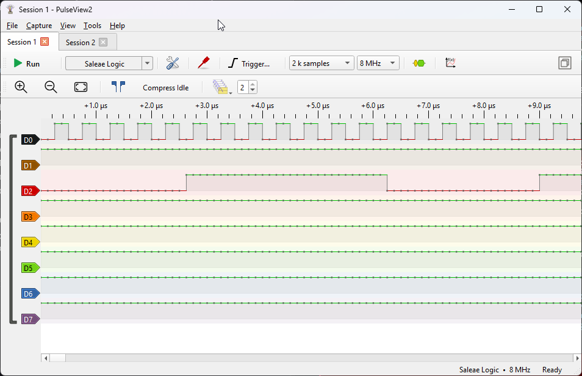

# PulseView2

**Bringing the pulse back to PulseView.**

**PulseView2** is an actively maintained fork of the open-source [sigrok](https://sigrok.org/) **PulseView** — the Qt-based logic analyzer, oscilloscope, and mixed-signal oscilloscope (MSO) graphical user interface.

For years, upstream PulseView has accumulated valuable community bugfixes, hardware improvements, and usability enhancements left unmerged across pull requests and independent forks, while modern toolchains and OS releases moved on. **PulseView2** brings those improvements together with a cleaner Qt 6 UI, major rendering performance upgrades, and automated cross-platform releases — putting the *pulse* back into PulseView.

---

## Highlights & Enhancements Over Upstream PulseView

### Modernized UI & Workflow
- **Cleaner layout & navigation:** Full application menu bar, live status bar, compact toolbars, and tabbed sessions with a one-click pop-out button to detach any view into a native OS window.
- **Smarter viewport & channel sizing:** Traces sit flush beneath the time ruler with an auto-hiding vertical scrollbar (only shown when channels overflow), plus browser-style **Increase / Decrease / Reset Channel Height** controls (`Ctrl++`, `Ctrl+-`, `Ctrl+0`) independent of horizontal time-axis zoom (`+` / `-`).
- **Compress Idle intervals:** Collapse long dead/idle stretches between bursts of signal activity so bursts can be inspected side-by-side.
- **Faster & cleaner cursor snapping:** Improved cursor snapping on large captures with nearest-sample snapping between edges, plus fixed ruler context-menu timestamps and *Trigger is zero time* alignment.
- **Classic PulseView channel palette:** Preserves the familiar resistor-code digital channel colors with automatic high-contrast label text.

### Protocol Decoder Performance & Stability
- **Responsive high-density decoding:** Binary-search annotation lookups and pixel-bucketed level-of-detail (LOD) rendering keep the UI smooth even when decoders (such as edge counters or long bus captures) emit hundreds of thousands of annotations.
- **Hardened memory & session lifecycle:** Fixed protocol decoder shutdown races and paused-restart deadlocks, hardened segment memory allocation against fault conditions, improved `.pvs` session save/restore, and added proper UI error reporting for export failures.

### Hardware & Capture Improvements
- **Dynamic sample rate & count updates:** Automatically refreshes supported sample rates and sample counts as channels are toggled (essential for analyzers whose maximum rate depends on active channel count).
- **Safer capture & device lifecycle:** Disables *Run* when no device is connected, cleanly closes serial/USB devices on session teardown, preserves open devices across rescans, and improves reconnect handling.
- **Expanded device options:** Added support for writable `SR_CONF_NUM_LOGIC_CHANNELS` and `SR_CONF_TEST_MODE` configuration keys, plus live trace updates when device settings change.

### Cross-Platform Qt 6 Releases
Automated GitHub Releases bundling **PulseView2** with the full sigrok stack (`libsigrok`, `libsigrokdecode`, protocol decoders, and `fx2lafw` firmware):
- **Windows (`x86_64`):** Installer (`.exe`) and portable `.zip`
- **macOS (`arm64` / Apple Silicon):** Self-contained `.dmg` app bundle
- **Linux (Ubuntu 26.04 LTS `amd64`):** `.deb` package with `sigrok-cli` and udev rules


---

## Building from Source

PulseView2 builds with CMake (>= 3.16), Ninja, Qt 6 (>= 6.2), Boost, `glibmm`, `libsigrokcxx`, and `libsigrokdecode` (targeting `libsigrok` / `libsigrokdecode` `master`):

```bash
cmake -S . -B build -G Ninja -DCMAKE_BUILD_TYPE=Release -DENABLE_TESTS=ON
ninja -C build
ctest --test-dir build --output-on-failure
```

---

## Upstream Project & Credits

PulseView2 builds directly on the work of the [sigrok](https://sigrok.org/wiki/PulseView) project and incorporates fixes and enhancements from community contributors and forks (including Sipeed, Terstegge, PentHertz, yuzhe-TheFool, and upstream `sigrokproject/pulseview` pull requests).

- **Upstream Website:** https://sigrok.org/wiki/PulseView
- **Upstream Repository:** https://github.com/sigrokproject/pulseview
- **Upstream Mailing List:** https://lists.sourceforge.net/lists/listinfo/sigrok-devel
- **IRC:** `#sigrok` on Libera.Chat

---

## License & Third-Party Resources

PulseView2 is licensed under the **GNU General Public License (GPL), version 3 or later** (GPLv3+). While some individual source files are licensed under GPLv2+, GPLv3+, or MIT, the application as a whole is licensed under GPLv3+. Please see individual source files for the full list of copyright holders.

### Bundled Third-Party Resources
- **Tango Icon Library** (`icons/application-exit.png`, `document-new.png`, `document-open.png`, `document-save-as.png`, `edit-paste.svg`, `help-browser.png`, `media-playback-pause.png`, `media-playback-start.png`, `preferences-system.png`, `search.svg`, `window-new.png`, `zoom-fit-best.png`, `zoom-in.png`, `zoom-out.png`) — Public Domain
- **Information icon** (`icons/information.svg`, Bobarino) — GFDL 1.2+ / CC-BY-SA 3.0
- **Add Math Channel icon** (`icons/add-math-channel.svg`, Inductiveload) — Public Domain
- **QHexView** (Victor Anjin) — MIT License
- **ExprTk** (Arash Partow) — MIT License
